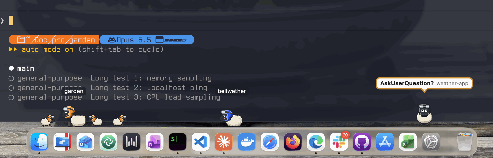

# Bellwether

Bellwether puts a sheep along the bottom of your screen for every Claude Code session you
have open. A session's subagents trot out beside it as lambs. When a session needs you (a
permission prompt, a question), its sheep turns to face you with a bubble saying what it
wants, and clicking the sheep takes you to that terminal.



You need [Claude Code](https://claude.com/claude-code) and a Mac (macOS 13 Ventura or
newer). Windows and Linux are planned.

## Install

With [Homebrew](https://brew.sh):

```
brew install --cask fanzoo/tap/bellwether
```

Or download the DMG from [the releases page](https://github.com/Fanzoo/bellwether/releases),
open it and drag Bellwether to Applications. The app is signed and notarized by Apple.

The cask also puts the `bellwether` command on your PATH (`/opt/homebrew/bin/bellwether`
on Apple silicon, `/usr/local/bin/bellwether` on Intel).

## First launch

Open Bellwether. A sheep appears in the menu bar, and a setup window walks you through the
rest. Nothing in your Claude Code settings changes until you click Install.

1. **Start at login** (recommended). Bellwether is two parts: a small background *brain*
   that Claude Code's hooks talk to, and the strip of sheep. Starting both at login means
   the hooks always find a brain. If macOS wants you to approve it, the window has a button
   for System Settings > General > Login Items: turn Bellwether on under "Allow in the
   Background".
2. **Hooks.** "Show the changes" shows exactly what installing adds to
   `~/.claude/settings.json`. Install writes it, after making a backup. Other tools' hooks
   are left exactly as they are.
3. **Sheep on the Dock** (optional). With the Accessibility permission, sheep stand on the
   Dock's top edge. Without it they walk the full width of the screen just above the Dock.
   Bellwether only reads where the Dock is; it never clicks or types for you.
4. **Click a sheep to jump to its tab** (optional). In iTerm2 and Terminal, picking the
   exact tab needs the Automation permission for that app; "Ask iTerm2" and "Ask Terminal"
   make macOS ask. Refusing is fine: a click still brings the app forward.
5. **Pet.** Bellwether's own sheep is the default. Import… adds a desktopPet pet file
   (`animations.xml`) of your own.
6. **The `bellwether` command** (optional). If Homebrew already put it on your PATH,
   there's nothing to do. Otherwise this makes a link at `~/.local/bin/bellwether`.
7. **Done** shows a health check, the same as `bellwether doctor`.

Now open a new Claude Code session: a sheep walks onto the strip. Ask Claude to run
something that needs your permission, and the sheep turns to face you with a bubble. If no
sheep appears, run `bellwether doctor`: it says what's wrong and what to do next.

To come back to the window later: menu-bar sheep > *Set up Bellwether…*.

## What the sheep mean

- A sheep **walks** (or **runs**, for shell commands) while its session works, and
  **sits** when the turn ends.
- It **grazes** after 20 s idle and **sleeps** after 10 minutes.
- It **lies down** while the session waits for you to type, is **dizzy** after an API
  error, **chews** while compacting, **trips** when a tool fails, and **leaves** when the
  session ends.
- **It needs you:** it stops, turns to face you and bounces, under a bubble such as
  `Bash: git push origin main?  · meadow` (the question, then the project). Amber is a
  permission prompt, blue an MCP question, purple a background session that needs input.
  After a few seconds, if the prompt is still open, it bounces higher and the bubble turns
  bold. There is no sound.
- **Lambs** are the session's subagents (Explore, code-reviewer, …), small sheep in their
  parent's colour. A lamb that needs you bounces under its own bubble, and its parent
  wears a small "lamb" tag. Beyond five lambs, a "+N" stands in for the rest.
- **Colours:** each session has its own colour, on its sheep's flight helmet, and keeps
  its colour and place across `/clear` and restarts. Two sessions in one project are told
  apart in their labels (`my-project · tab 2`).
- **Hover** over a sheep to see its project; **click** it to bring its terminal forward.
  Bubbles and the space between sheep let clicks through to whatever is underneath, and a
  sheep fades while the cursor is near it.
- **More than one monitor:** each sheep lives on the monitor where its terminal window is.

## Settings and pets

**The menu-bar sheep:**
- *Quiet (alerts only)*: the sheep go away, and only a session that needs you shows a small
  "!". Clicks pass through the whole strip. Same as `bellwether mute` / `bellwether unmute`.
- *Hide everything (for screen sharing)*: hides the whole strip, "!" included. Same as
  `bellwether hide` / `bellwether show`. Both are remembered across restarts.
- *Show labels*: every sheep shows its project's name.
- *Set up Bellwether…*: the setup window again.
- *Check for Updates…*: see [Updates](#updates).
- *Quit Bellwether*: quits the strip. The brain keeps running if it starts at login, so
  Claude Code's hooks still have something to talk to; the strip comes back at your next
  login, or with `bellwether shell start`.

**Screen sharing and full screen.** The strip asks macOS to leave it out of screen
captures, and it hides itself while Zoom is sharing your screen. Teams and Google Meet in
a browser can't be detected: use *Hide everything (for screen sharing)* first. The strip
stays off full-screen apps.

**config.json.** Bellwether runs without one. To change something, create
`~/Library/Application Support/Bellwether/config.json` with just the keys you want; every
missing key keeps its default. [`config.example.json`](config.example.json) shows them
all (the app ignores `brain.nodePath` and `autostart` there). For example:

```
{
  "bubble": { "detail": "tool" },
  "pets": { "tint": "whole" },
  "updates": { "check": "off" }
}
```

- `bubble.detail: "tool"` makes a bubble say only `Bash?`, never the command.
- `bubble.redactPatterns` adds your own patterns to hide in bubbles.
- `pets.tint: "whole"` colours the whole pet instead. By default only the pet's magenta
  parts take the session colour: the helmet on Bellwether's sheep, the horns on an eSheep.
  An imported pet with nothing drawn in magenta shows no session colour unless you set
  `"whole"`.
- `privacy.sharingProcesses` lists the processes that hide the strip while they run.
- `fade.radiusPx` and `fade.opacity` set how near the cursor makes a sheep fade, and how
  far.

The strip reads `config.json` when it starts: run `bellwether shell restart` after
editing it. The `bubble` and `behaviour` keys belong to the brain, which reads them when it
starts (at your next login). `bellwether doctor` says if the file has a mistake.

**Pets.** The default pet is Bellwether's own sheep, in a flight helmet that takes the
session's colour. You can use any pet in the
[desktopPet](https://github.com/Adrianotiger/desktopPet) format (an `animations.xml`
file): import it in the setup window's Pet step and choose it there, or from a terminal:

```
bellwether pets import ~/Downloads/mypet/animations.xml
```

The import checks the file, copies it into Bellwether's folder and pins it, then prints
the `pets.default` and `animationMap` lines to put in `config.json`.

## Commands

The setup window and the menu bar cover everyday use. The `bellwether` command is there
for a terminal; `bellwether help` lists everything.

| Command | What it does |
|---|---|
| `bellwether status [--watch]` | The flock as text: each session's state and what it's waiting for. `--watch` keeps it updated |
| `bellwether doctor` | Checks the app, its brain, the hook token, the hooks and the login items, and says what to do next |
| `bellwether mute` / `unmute` | The menu's *Quiet (alerts only)* |
| `bellwether hide` / `show` | The menu's *Hide everything (for screen sharing)* |
| `bellwether shell start` / `stop` / `restart` | Starts, stops or restarts the strip |
| `bellwether hooks install`, then `bellwether hooks install --write` | Shows the change to `~/.claude/settings.json`, then makes it (with a backup) |
| `bellwether hooks uninstall --write` | Removes Bellwether's hooks, and only those |
| `bellwether hooks print` | The hooks as a settings file of their own, for `claude --settings <file>` |
| `bellwether autostart status` / `install --write` / `uninstall --write` | Start at login, on or off |
| `bellwether pets import <animations.xml>` | Adds a pet of your own |
| `bellwether token rotate --write` | A new hook token, with the hooks updated to match |
| `bellwether version` | The version you're running |

Without `--write`, `hooks` and `autostart` only show what they would change.

## What Bellwether shows, and what it keeps

- **Bubbles** show the tool and one detail: the shell command, a file's name, a web
  address's host, a search, or the subagent type. Anything that looks like a secret
  (`GITHUB_TOKEN=…`, passwords, Authorization headers, credentials in a URL, common token
  formats, your `bubble.redactPatterns`) becomes `•••`, and long text is cut short. With
  `bubble.detail: "tool"` a bubble shows only the tool's name.
- **Nothing leaves your Mac.** The brain listens on `127.0.0.1` only. The one connection
  Bellwether makes is the update check, to GitHub.
- **Files**, all in `~/Library/Application Support/Bellwether/`: `hook-token` (readable
  only by you), `config.json` if you made one, `state.json` (each session's colour and
  place, and Quiet), `shell-state.json` (Hide everything, Show labels), imported pets, and
  backups of your settings file from each hook install.
- **Logs**, in `~/Library/Logs/Bellwether/`: one line per event or sheep, never the text of
  a bubble or a command.

## Safe by design: Bellwether only watches

- **It can never approve or block anything for you.** Claude Code reads an answer from a
  hook as a decision. Bellwether's hook only ever answers with an empty reply, so every
  permission prompt is still yours to answer.
- **It can't slow Claude Code down.** Each of its hook entries has a 1-second timeout. If
  Bellwether hangs or isn't running, a tool call waits one second at most.
- **Other apps can't fake a sheep.** The brain listens on `127.0.0.1` only, and refuses
  anything from a web page (an `Origin` header), with a foreign `Host`, that isn't JSON,
  or without your hook token.

## Updates

Bellwether checks for a new version shortly after it starts and then once a day, and asks
before installing it ("Install and Relaunch" or "Later"). *Check for Updates…* in the
menu-bar menu checks right away. Updates are signed; the app refuses anything else. To turn
the automatic checks off, set `"updates": {"check": "off"}` in `config.json`; *Check for
Updates…* still works.

After an update, Bellwether restarts its brain on the new version as it relaunches; your
sessions may show one brief "hook error" line meanwhile. `bellwether doctor` warns if the
brain still runs another version than the app, and says how to restart it.

What changed in each version is in [CHANGELOG.md](CHANGELOG.md).

## Uninstall

Homebrew can't edit Claude Code's settings, so first remove Bellwether's hooks and its
login items:

```
bellwether hooks uninstall --write
bellwether autostart uninstall --write
```

Then:

```
brew uninstall --cask bellwether          # keeps your settings and hook token
brew uninstall --zap --cask bellwether    # also deletes ~/Library/Application Support/Bellwether
```

Installed from the DMG? Run the same two `bellwether` commands (as
`/Applications/Bellwether.app/Contents/MacOS/Bellwether` if the command isn't on your
PATH), then drag Bellwether to the Trash.

## Licensing

- The code is MIT ([`LICENSE`](LICENSE)).
- Bellwether's own sheep is CC0-1.0 ([`pets/LICENSE`](pets/LICENSE)), in this repository
  and bundled with the app.
- Bellwether plays the pet format of
  [desktopPet](https://github.com/Adrianotiger/desktopPet) by Adriano (MIT), and its
  eSheep is the inspiration.
- The eSheep art is not included: its licence is unclear, so it is
  never committed or bundled. If you have a desktopPet file of it, import it (see
  [Settings and pets](#settings-and-pets)).

[`NOTICE`](NOTICE) has the credits, and [`THIRD-PARTY.md`](THIRD-PARTY.md) every
dependency's licence.

## Building from source

Building the app, running Bellwether from a checkout, the tests and the conformance suite
are in [docs/DEVELOPMENT.md](docs/DEVELOPMENT.md).
